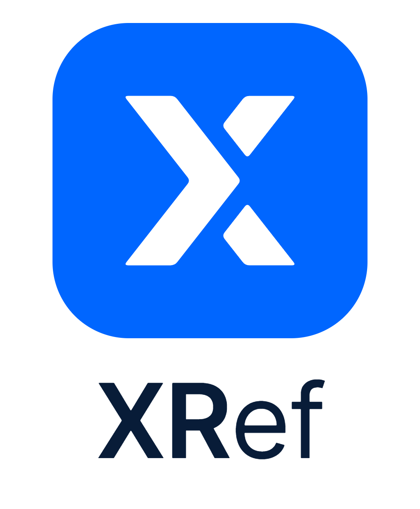

XRef — A Reference Board for Images, Videos and Ideas
======================================================

XRef lets you quickly arrange your reference images, videos and PDFs and view
them while you create. Its minimal interface is designed not to get in the
way of your creative process.

XRef is a fork of `BeeRef <https://github.com/rbreu/beeref>`_ by Rebecca Breu,
extended with video playback, multi-page PDFs, node-style links between
references, a pen for notes and sketches, shared boards and a Turkish
interface.

Features
--------

* Reference images (PNG, JPG, WebP, GIF, ...), videos (MP4, MOV, WebM, ...) and
  multi-page PDFs
* Frameless, PureRef-like window: double click the empty canvas for full
  screen, an always-on-top mode and resizable edges
* Infinite canvas with pan, zoom, rotate, flip, crop, arrange and normalize
* Video playback with a DaVinci-Resolve-like hover scrub (red playhead), a
  remembered preview frame, play/pause, mute and volume controls
* PDFs behave like videos: hover to flip through the pages, the last shown page
  is remembered and restored when the board is opened again
* Node-editor style links between items: drag from the port on the item's edge,
  or use Tools -> Link Selected Items; linked children can be moved together
  with Ctrl+drag
* Pen mode for freehand notes and sketches (Alt double-tap): brush colour and
  four brush sizes, smooth strokes
* Text notes, opacity, grayscale and colour gamut view
* Drag & drop of images, videos, PDFs, boards, text, HTML, text files and links;
  dragging a selection out of the window copies it to other applications
* Shared boards over the local network, paired with a session code (no IP
  addresses): authenticated, encrypted, with host approval, and the session
  continues on another peer if the host goes away
* Turkish and English interface (Settings -> Miscellaneous -> Language)
* Autosave with a configurable interval

Installation
------------

XRef runs on Windows, Linux and macOS and needs Python 3.9 - 3.12 with PyQt6.

.. code-block:: console

   pip install git+https://github.com/exedesign/xref.git
   xref

To run it from a checkout:

.. code-block:: console

   pip install -r requirements/dev.txt
   python -m xref

Board files
-----------

Boards are saved as ``.xref`` files, a SQLite database. Boards saved by older
versions (and by BeeRef) use ``.bee`` and open as usual; use *File -> Save As*
to store them in the new format.

Images are embedded as PNG, JPG or WebP (depending on the "Image Storage
Format" setting). Videos are referenced by their source path instead of being
copied, and are only embedded when the original file is no longer available.
PDFs are always embedded in full, so every page can be rendered at any size.
Images (and any embedded videos) live in an ``sqlar`` table, so they can be
extracted with the `sqlite command line program
<https://www.sqlite.org/cli.html>`_:

.. code-block:: console

   sqlite3 myfile.xref -Axv

Troubleshooting
---------------

You can access the log output via *Help -> Show Debug Log*.

License
-------

XRef is free software, licensed under the GNU General Public License v3. It is
based on BeeRef, Copyright (C) 2021-2024 Rebecca Breu, and keeps the original
copyright and license notices.
