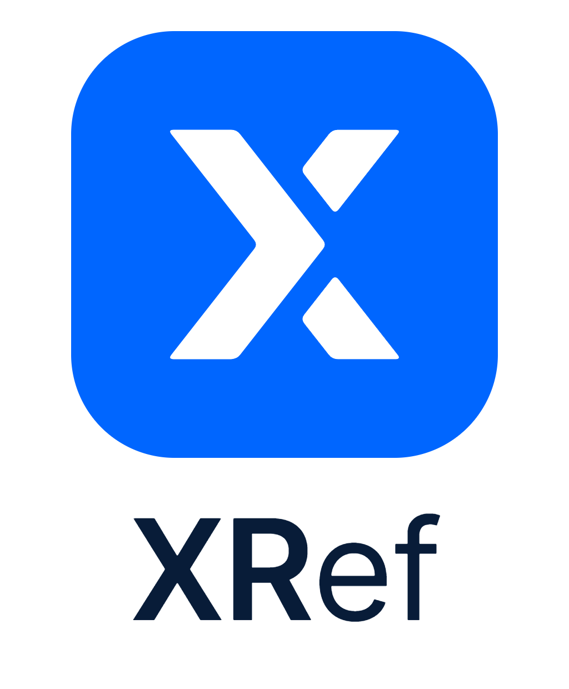

XRef — A Reference Board for Images, Videos and Ideas
======================================================

XRef lets you quickly arrange your reference images, videos, PDFs and 3D
models and view them while you create. Its minimal interface is designed
not to get in the way of your creative process.

XRef is a fork of `BeeRef <https://github.com/rbreu/beeref>`_ by Rebecca Breu,
extended with video playback, multi-page PDFs, node-style links between
references, a pen for notes and sketches, shared boards and a Turkish
interface.

XRef — Görseller, Videolar ve Fikirler İçin Referans Tahtası (Türkçe)
======================================================================

XRef ile referans görsellerinizi, videolarınızı, PDF'lerinizi ve 3D
modellerinizi hızla düzenleyebilir, yaratırken yanınızda tutabilirsiniz.
Sade arayüzü, yaratıcı sürecinizin önüne geçmemek için tasarlandı.

Yenilikler (0.5.0)
------------------

* **PureRef tarzı referans ızgarası** (Ayarlar -> Görünüm -> Referans
  Izgarası): nokta ızgara, kare ızgara ya da kapalı. Izgara tuvalin
  üzerinde yaşar, yani görsellerle birlikte yakınlaşıp kayar; aralık
  10-500 px arasında ayarlanabilir. Rengi tuval rengine göre kendini
  ayarlar (koyu tuvalde açık, açık tuvalde koyu ton), çok yoğunlaşınca
  seyrekleşir ve kaydırırken kaymaz
* **Izgaraya yapışma** (Ayarlar -> Görünüm -> Izgaraya Yapış):
  sürüklerken öge en yakın ızgara kesişimine atlar. Yalnızca fare ile
  sürüklerken çalışır; dosya yükleme, *Yerleştir* ve geri al/yinele tam
  koordinatlarını korur
* **three.js OrbitControls ile 3D gezinme**: modeli düz sürükleyerek
  tahtada istediğiniz yere taşıyın, kamerayı devralmak için
  **Ctrl+Sol tık** yapın (sol sürükle = yörünge, sağ sürükle = kaydırma,
  orta tuş/tekerlek = yakınlaştırma, Shift = yörünge/kaydırma takası).
  Kamerayı bırakmak için tekrar Ctrl+Sol tık ya da Esc
* **Model yönü düzeltildi**: F3D'den gelen görüntü alt-üst ters
  yerleşiyordu; artık tüm modeller doğru yönde açılır. *Varsayılan 3D
  Model Yukarı Ekseni* ayarı (Ayarlar -> Performans) Z/Y/X arasında
  gerçekten çalışır
* **Daha akıcı 3D önizleme**: her karede siyah ekrana düşme bitti; son
  iyi kare her zaman çizilir. Model üzerindeki tüm yazılar ve eksen
  gizmosu kaldırıldı — fare gezinirken model artık dönmez
* **Daha sağlam web paylaşımı**: sunucu 20 sn'de bir WebSocket
  canlılık sinyali gönderir, kopan bağlantı sınırsız yeniden dener,
  yarı-açık soketleri bir bekçi (watchdog) yakalar ve WebSocket
  engelliyse sayfa HTTP yoklamasına düşer

Öne Çıkanlar
------------

* Referans medya: görseller (PNG, JPG, WebP, GIF, ...), videolar (MP4, MOV,
  WebM, ...), çok sayfalı PDF'ler ve 3D modeller. Windows'ta F3D; OBJ, STL,
  PLY, FBX, glTF/GLB, 3MF, STEP, IFC ve kurulu okuyucuların sunduğu diğer
  biçimleri GPU hızlandırmalı olarak işler
* Çerçevesiz, PureRef benzeri pencere: boş tuvale çift tıklayarak tam ekran,
  pencereyi taşımak için sağ tıklayıp sürükleme, her zaman üstte modu ve
  kenarlardan boyutlandırma; küçült/tam ekran/kapat düğmeleri kısa bir
  gecikmeyle sağ
  üstte belirir. Her sahne kendi pencere konumunu ve boyutunu tahta dosyası
  içinde hatırlar (Ayarlar -> Görünüm -> Sahne Yerleşimlerini Hatırla)
* Sonsuz tuval: kaydırma, yakınlaştırma, döndürme, çevirme, kırpma,
  hizalama (rastgele dahil) ve boyut eşitleme; tuval rengi ayarlanabilir
* PureRef tarzı referans ızgarası: nokta ya da kare ızgara, ayarlanabilir
  aralık ve isteğe bağlı ızgaraya yapışma (Ayarlar -> Görünüm)
* Video oynatma: DaVinci Resolve benzeri üzerine gelince tarama (kırmızı
  oynatım kafası), hatırlanan önizleme karesi, oynat/duraklat, sessize alma
  ve ses seviyesi; tek tıklama imlecin altındaki kareyi kilitler
* PDF'ler video gibi çalışır: sayfaların arasında gezinmek için üzerine
  gelin, son gösterilen sayfa hatırlanır ve tahta yeniden açıldığında
  geri yüklenir
* 3D modeller: three.js OrbitControls ile birebir gezinme. Modeli düz
  sürükleyerek tahtada taşıyın; kamerayı devralmak için **Ctrl+Sol tık**
  yapın (sol sürükle = yörünge, sağ sürükle = kaydırma, orta tuş/tekerlek =
  yakınlaştırma, Shift = takas), bırakmak için tekrar Ctrl+Sol tık ya da
  Esc. Windows'ta F3D/libf3d ile GPU hızlandırmalı rendering; F3D okuyucusu
  bulunmayan USD/USDZ dosyalarının geometrisi OpenUSD ile okunup F3D
  üzerinden GPU hızlandırmalı görüntülenir
* Medya başlıkları: görsel, video, PDF ve modeller dosya adlarını tuvalde
  gösterebilir (Ayarlar -> Çeşitli -> Medya Başlıklarını Göster)
* Ögeler arası düğüm bağlantıları: bir ögeden diğerine **Shift+sürükle**
  ya da Araçlar -> Seçili Ögeleri Bağla; bağlı alt ögeler Ctrl+sürükle ile
  birlikte taşınabilir; bağlantıya tıklayıp seçin, Delete ile kaldırın
* Kalem modu: serbest el notları ve eskizler (Alt çift dokunuş), fırça
  rengi ve dört fırça boyu, yumuşak çizgiler, artı şekil araçları
  (Shift ile dikdörtgenlerden kare/elipslerden daire, düz çizgiler)
* Metin notları, saydamlık, gri tonlama ve renk aralığı görünümü
* Çoğalt (Ctrl+D), seçimi küçük bir ofsetle kopyalar
* Sürükle-bırak: görsel, video, PDF, 3D model, tahta, metin, HTML ve
  bağlantılar; seçimi pencerenin dışına sürüklemek onu diğer uygulamalara
  kopyalar
* Paylaşılan tahtalar: oturum koduyla yerel ağ üzerinden (IP adresi
  gerekmez) — kimlik doğrulamalı, şifreli, sunucu onaylı; sunucu ayrılırsa
  oturum başka bir eşte devam eder. *Web Bağlantısı Oluştur* herhangi bir
  tarayıcıda **canlı WebRTC aynası** açar: misafirler tahtayı video olarak
  görür, kendi fare ve klavyeleriyle yönetir, rastgele bir misafir adı
  alır (adları sunucunun masaüstünde imleçlerinde görünür) ve medya
  dosyalarını doğrudan tarayıcıya bırakabilir — her yükleme tahtada bir
  ilerleme kutusu gösterir. Misafirler yalnızca kendi oluşturdukları
  ögeleri silebilir. *Web Bağlantısı Oluştur (İnternet)* tahtayı yerel ağ
  dışına açar (localhost.run tüneli). Bağlantı koptuğunda kendini toparlar:
  sınırsız yeniden bağlanma, tüneli açık tutan canlılık sinyalleri ve
  WebSocket engelliyse HTTP yoklaması
* Türkçe ve İngilizce arayüz (Ayarlar -> Çeşitli -> Dil)
* Ayarlanabilir aralıkla otomatik kaydetme

Kurulum (Windows)
-----------------

**Windows**: `Releases <https://github.com/exedesign/xref/releases>`_
sayfasından tek dosyalık ``XRef-<sürüm>.exe`` dosyasını indirin ve
çalıştırın — kuruluma gerek yoktur.

Kurulum (Python)
----------------

XRef Windows, Linux ve macOS üzerinde çalışır; Python 3.9 - 3.12 ve PyQt6
gerekir. Windows'ta F3D 3D görüntüleyici için Python 3.10+ ve 64-bit
Python gerekir.

.. code-block:: console

   pip install git+https://github.com/exedesign/xref.git
   xref

Kaynak koddan çalıştırmak için:

.. code-block:: console

   pip install -r requirements/dev.txt
   python -m xref

What's New in 0.5.0
-------------------

* **PureRef-style reference grid** (Settings -> Appearance -> Reference
  Grid): dot grid, square grid or off. The grid lives on the canvas, so it
  zooms and pans together with the images; the spacing is adjustable between
  10 and 500 px. Its colour follows the canvas (a light tint on a dark board,
  a dark one on a light board), it thins out when it gets too dense, and it
  does not swim while you pan
* **Snap to grid** (Settings -> Appearance -> Snap to Grid): while dragging,
  an item jumps to the nearest grid intersection. It only applies to mouse
  drags, so loading files, *Arrange* and undo/redo keep exact positions
* **three.js OrbitControls 3D navigation**: drag a model to move it on the
  board, then **Ctrl+click** it to take its camera over (left-drag orbits,
  right-drag pans, middle-drag or the wheel zooms, Shift swaps orbit and
  pan). Ctrl+click again, or press Escape, to move it again
* **Model orientation fixed**: the image coming back from F3D was placed
  upside down; every model now opens the right way up. The *Default 3D Model
  Up Axis* setting (Settings -> Performance) really switches between Z, Y
  and X
* **Smoother 3D preview**: the black-frame flashing is gone, the last good
  frame is always drawn, and every label plus the axis gizmo was removed from
  the model - hovering no longer rotates it
* **More resilient web sharing**: the server sends a WebSocket heartbeat
  every 20 seconds, dropped connections retry with no attempt limit, a
  watchdog catches half-open sockets, and the page falls back to HTTP
  polling when WebSockets are blocked

Features
--------

* Reference images (PNG, JPG, WebP, GIF, ...), videos (MP4, MOV, WebM, ...),
  multi-page PDFs and 3D models. On Windows, F3D supports GPU-accelerated
  rendering for OBJ, STL, PLY, FBX, glTF/GLB, 3MF, STEP, IFC and other formats
  provided by the installed readers
* Frameless, PureRef-like window: double click the empty canvas for full
  screen, right-click and drag anywhere to move the window, always-on-top,
  and resizable edges; minimize/full screen/close buttons appear in the top right
  corner after a short delay. Each scene can remember its own window
  position and size, stored inside the board file
  (Settings -> View -> Remember Scene Layouts)
* Infinite canvas with pan, zoom, rotate, flip, crop, arrange (including
  randomly) and normalize; the canvas colour is configurable
* PureRef-style reference grid with dots or squares, an adjustable spacing
  and optional snapping while dragging (Settings -> Appearance)
* Video playback with a DaVinci-Resolve-like hover scrub (red playhead), a
  remembered preview frame, play/pause, mute and volume controls; a single
  click locks the frame under the pointer
* PDFs behave like videos: hover to flip through the pages, the last shown page
  is remembered and restored when the board is opened again; a single click
  locks the page
* 3D models navigated exactly like three.js OrbitControls: drag a model to
  move it on the board, **Ctrl+click** it to take its camera over (left-drag
  orbits, right-drag pans, middle-drag or the wheel zooms, Shift swaps orbit
  and pan), Ctrl+click again or press Escape to move it again. On Windows,
  models are rendered with GPU acceleration by F3D/libf3d; for USD/USDZ
  formats unavailable in the F3D readers, OpenUSD reads the geometry and F3D
  renders it on the GPU
* Media titles: images, videos, PDFs and models can show their file name on
  the canvas (Settings -> Miscellaneous -> Show Media Titles)
* Node-editor style links between items: **Shift+drag** from one item to
  another, or use Tools -> Link Selected Items; linked children can be moved
  together with Ctrl+drag; click a link to select it, Delete removes it
* Pen mode for freehand notes and sketches (Alt double-tap): brush colour and
  four brush sizes, smooth strokes, plus shape tools (rectangles, ellipses
  with Shift for squares/circles, straight lines)
* Text notes, opacity, grayscale and colour gamut view
* Duplicate (Ctrl+D) copies the selection with a small offset
* Drag & drop of images, videos, PDFs, 3D models, boards, text, HTML, text
  files and links; dragging a selection out of the window copies it to other
  applications
* Shared boards over the local network, paired with a session code (no IP
  addresses): authenticated, encrypted, with host approval, and the session
  continues on another peer if the host goes away. *Create Web Link*
  (Collaborate menu) opens a **live WebRTC mirror** of the board in any
  browser: guests see the canvas as video, control it with their own mouse
  and keyboard, get a random guest name (shown on the host's desktop at
  their cursor) and can drop media files straight into the browser - each
  upload shows a progress placeholder on the board. Guests may only delete
  the items they created themselves. *Create Web Link (Internet)* exposes the
  board outside the local network through a plain-SSH tunnel (localhost.run).
  Connections recover on their own: unlimited reconnects, heartbeats that
  keep the tunnel warm, and HTTP polling when WebSockets are blocked
* Turkish and English interface (Settings -> Miscellaneous -> Language)
* Autosave with a configurable interval

Installation
------------

**Windows**: download the standalone ``XRef-<version>-windows-x86_64.exe``
from the `Releases <https://github.com/exedesign/xref/releases>`_ page and
run it - no installation required. On first launch, the packaged app
registers ``.xref`` and legacy ``.bee`` boards as XRef file types for the
current Windows user. Windows may ask you to select XRef under
**Settings -> Apps -> Default apps** to make it the default opener.

XRef also runs on Windows, Linux and macOS and needs Python 3.9 - 3.12 with
PyQt6. The F3D 3D viewer on Windows requires 64-bit Python 3.10 or later.

.. code-block:: console

   pip install git+https://github.com/exedesign/xref.git
   xref

To run it from a checkout:

.. code-block:: console

   pip install -r requirements/dev.txt
   python -m xref

Board files
-----------

Boards are saved as ``.xref`` files, a SQLite database. Boards saved by older
versions (and by BeeRef) use ``.bee`` and open as usual; use *File -> Save As*
to store them in the new format.

Images are embedded as PNG, JPG or WebP (depending on the "Image Storage
Format" setting). Videos are referenced by their source path instead of being
copied, and are only embedded when the original file is no longer available.
PDFs are always embedded in full, so every page can be rendered at any size.
Images (and any embedded videos) live in an ``sqlar`` table, so they can be
extracted with the `sqlite command line program
<https://www.sqlite.org/cli.html>`_:

.. code-block:: console

   sqlite3 myfile.xref -Axv

Troubleshooting
---------------

You can access the log output via *Help -> Show Debug Log*.

License
-------

XRef is free software, licensed under the GNU General Public License v3. It is
based on BeeRef, Copyright (C) 2021-2024 Rebecca Breu, and keeps the original
copyright and license notices.
